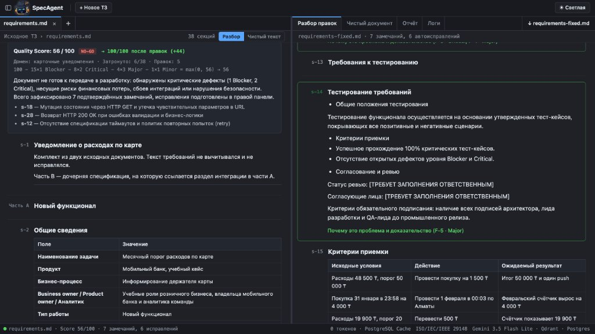
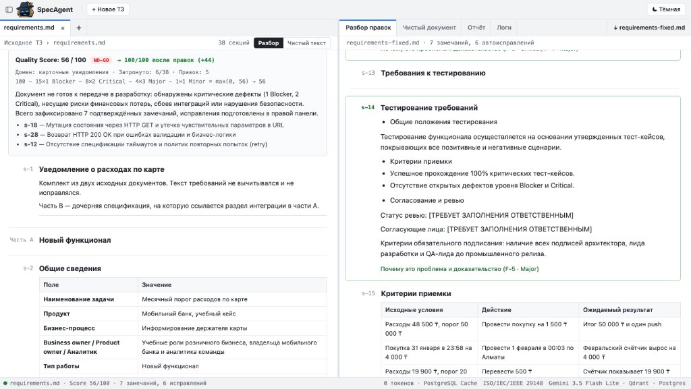
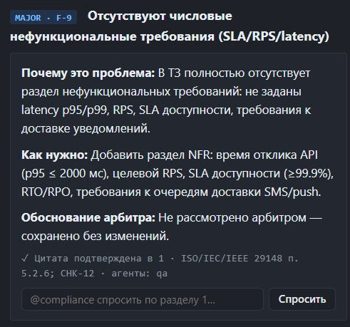

<p align="center">
  
</p>

<h1 align="center">SpecAgent</h1>

<p align="center">
  <strong>Мультиагентный FinTech-аудитор и автоисправитель технических заданий (ТЗ)</strong><br/>
  ISO/IEC/IEEE 29148:2018 · IEEE 830 · PCI DSS · Комплаенс НБРК / АРРФР · RAG (Qdrant) · Event Sourcing (PostgreSQL)
</p>

<p align="center">
  
</p>
<p align="center">
  
</p>

---

## Быстрый запуск (одной командой)

### Что понадобится
- **Docker** (Docker Desktop или OrbStack на macOS) — для запуска всего стека (`PostgreSQL` + `Qdrant` + `API` + `Web UI`)
- Бесплатный API-ключ **Google Gemini** (`GEMINI_API_KEY`) — используется и для LLM (`gemini-3.5-flash-lite` / `gemini-3.8-flash`), и для векторного поиска Qdrant (`gemini-embedding-001`)
- *(Опционально)* **.NET 10 SDK** — для запуска в режиме CLI без Docker и прогона unit-тестов

### Шаг 1. Клонируйте репозиторий и перейдите в папку проекта

```bash
git clone https://github.com/Raimbek-pro/SpecAgent.git
cd SpecAgent
```

### Шаг 2. Получите бесплатный `GEMINI_API_KEY` и создайте `.env`

1. Откройте **Google AI Studio**: https://aistudio.google.com/apikey
2. Войдите через Google-аккаунт, нажмите **Create API key** и скопируйте ключ.
3. Скопируйте шаблон переменных окружения (`.env` находится в `.gitignore` — **никогда не коммитьте реальные ключи**):

```bash
cp .env.example .env
```

4. Откройте `.env` и вставьте свой ключ в `GEMINI_API_KEY`:

```env
GEMINI_API_KEY=ваш_ключ_google_ai_studio
```

### Шаг 3. Запустите проект одной командой

Находясь **в корневой папке проекта (`SpecAgent`)**, выполните:

```bash
docker compose up --build -d
```

После запуска будут доступны:
- **Веб-интерфейс и API SpecAgent:** http://localhost:5199
- **Интерактивная документация API (Scalar):** http://localhost:5199/scalar/v1 (OpenAPI JSON: `/openapi/v1.json`)
- **Health check:** http://localhost:5199/health
- **Панель Qdrant:** http://localhost:6333/dashboard
- **PostgreSQL:** `localhost:5432` (`specagent` / `specagent`)
- **Постоянные тома (volumes):** `pgdata` (PostgreSQL), `qdrant_data` (Qdrant), `specagent_uploads` (`/app/uploads`) и `specagent_knowledge` (`/app/knowledge`) сохраняются между пересборками.

Пересборка только API-контейнера после правки кода (без потери данных в БД и RAG):

```bash
docker compose up --build -d api
```

---

### Альтернатива: запуск CLI одной командой (без Docker)

Проверить любой файл `.pdf`, `.docx`, `.md` или `.txt` одной командой из корня репозитория и получить готовый отчёт `report.md` (файл `.env` подхватывается автоматически):

```bash
dotnet run --project doc1/prototype/src/SpecAgent.Api -- --input doc1/prototype/dataset/specs/bcc-card-expenses.md --output report.md
```

Дополнительные флаги:
- `--fixed <путь>` — дополнительно сохранить исправленную версию ТЗ (`.md`, `.pdf` или `.docx` определяется по расширению)
- `--with-gherkin` — включить сценарии Gherkin в исправленный файл `--fixed`
- `--help` — справка по CLI

### Локальный запуск Web UI (без Docker)

```bash
cd doc1/prototype
dotnet run --project src/SpecAgent.Api
```

### Запуск unit-тестов (0 токенов LLM)

Все 50 unit-тестов используют детерминированные заглушки и не требуют API-ключей:

```bash
cd doc1/prototype
dotnet test --nologo
```

---

## О проекте

**SpecAgent** — мультиагентная система на **C# / .NET 10** для аудита, скоринга и автоматического исправления банковских и FinTech технических заданий (`.pdf`, `.docx`, `.md`, `.txt`).

В отличие от простых обёрток над одним промптом, SpecAgent выполняет **4-уровневый детерминированный + мультиагентный пайплайн** с хранением трассировки в **PostgreSQL Event Store**, семантическим **RAG в Qdrant** и **маскированием ПДн до отправки в LLM**:

1. **Парсинг и маскирование ПДн (`SpecAgent.Ingestion`)**
   - Layout-aware парсер PDF (`PdfPig`) с извлечением таблиц (с границами и без) в Markdown.
   - Парсер Word `.docx` (`DocumentFormat.OpenXml`) с сохранением структуры заголовков и таблиц.
   - Детерминированный PII-маскер срабатывает **до** выхода текста за периметр: маскирует секреты/пароли, IBAN (`KZ...`), PAN (валидация по алгоритму Луна), ИИН/БИН РК (контрольная сумма mod-11 и явные метки), международные и локальные телефоны (`+1`, `+44`, `+7`, `+998`, `8...`), email и IPv4. Реальные значения восстанавливаются только при просмотре и экспорте.
2. **Параллельный мультиагентный аудит (`SpecAgent.Agents`)**
   - **Supervisor Agent** определяет домен/сложность и маршрутизирует разделы к профильным агентам.
   - **Детерминированный движок правил (`RuleBasedCritic`)** ловит критичные дефекты за 0 токенов (например, мутирующий `GET`, HTTP `200 OK` с `"result": "ERROR"`, незаполненные разделы-заглушки).
   - **Профильные критики (параллельный fan-out):** `logic`, `qa`, `compliance`, `distributed` + единый **Batch Checklist Agent** (`CHK-01`..`CHK-12`, ISO 29148).
   - **Кросс-секционный индекс (`DocumentIndex`)** сверяет статусы, эндпоинты, лимиты и SLA между разделами без траты токенов.
   - **Семантический RAG (`Qdrant` + `gemini-embedding-001`)** подтягивает банковские стандарты, ISO/IEC/IEEE 29148 и загруженные вручную регламенты банка.
3. **Проверка цитат и арбитраж (`MetaCriticAgent`)**
   - Проверяет каждую цитату по исходному тексту документа (отсекая галлюцинации).
   - Убирает дубликаты, назначает итоговую критичность (`Blocker`, `Critical`, `Major`, `Minor`), рассчитывает **Quality Score (0–100)** и вердикт **GO / УСЛОВНЫЙ GO / NO-GO**.
4. **Автоисправление и нативный экспорт (`PatchLoop` + `DocumentExporter`)**
   - Группирует замечания по разделам и переписывает каждый проблемный раздел в готовую к разработке редакцию.
   - Запускает цикл верификации `PatchWriter → PatchVerifier` для `Blocker` / `Critical`, чтобы исключить новые противоречия с соседними разделами.
   - Экспортирует исправленное ТЗ в **исходном формате**: чистый **`.pdf`** (`QuestPDF` + кириллический шрифт `DejaVu Sans`), чистый **`.docx`** (`OpenXML`), чистый **`.md`**, а также официальный отчёт **`report.md`**.

---

## Интерактивный режим Human-in-the-Loop (`@agent` Q&A)

В каждой карточке замечания в правой панели есть встроенный чат с профильными агентами — аналитик может задать уточняющий вопрос по конкретному разделу ТЗ:

<p align="center">
  
</p>

| Упоминание | Профильный агент | Пример вопроса |
|---|---|---|
| `@compliance` | ИБ, PCI DSS, НБРК / АРРФР, ПДн, IDOR | `@compliance проверь этот эндпоинт на IDOR и PCI DSS` |
| `@distributed` | Идемпотентность, таймауты, ретраи, Saga, гонки | `@distributed как защититься от двойного списания при таймауте?` |
| `@logic` | Машины состояний, API-контракты, типы, противоречия | `@logic есть ли противоречия со статусами в разделе 3?` |
| `@qa` | Проверяемость, Gherkin-сценарии, SLA / NFR | `@qa напиши негативные Given/When/Then сценарии для этого раздела` |

**Как это работает (`POST /api/audits/{id}/ask`):**
- **Полный контекст:** выбранный критик получает текст раздела, релевантные правила из **Qdrant RAG**, подтверждённые замечания, сгенерированный патч и историю диалога.
- **Защита ПДн:** вопросы аналитика маскируются до отправки в LLM, а ответы демаскируются на выходе.
- **Аудируемость:** события `HUMAN_QUESTION` и `AGENT_ANSWER` сохраняются в PostgreSQL (также доступно для тестирования в **Scalar** по адресу `/scalar/v1`).

---

## Основные API-эндпоинты

| Метод | Эндпоинт | Описание |
|---|---|---|
| `GET` | `/health` | Проверка состояния сервиса (без авторизации) |
| `GET` | `/metrics` | Метрики Prometheus (`specagent_audits_*`, `specagent_llm_tokens_*`, `specagent_llm_cost_usd_total`) |
| `GET` | `/api/me` | Текущий пользователь, роль (`admin`/`analyst`) и режим авторизации (`jwt`/`demo`) |
| `GET` | `/api/audits/recent` | Список последних аудитов из PostgreSQL (оценка, токены, стоимость в USD) |
| `POST` | `/api/audits` | Загрузка `.pdf`, `.docx`, `.md` или `.txt` для запуска аудита |
| `GET` | `/api/audits/{id}/events` | Поток событий выполнения в реальном времени (SSE) |
| `GET` | `/api/audits/{id}/document` | Демаскированные разделы распарсенного документа |
| `GET` | `/api/audits/{id}` | Итоговый JSON-отчёт аудита (`findings`, `patches`, `qualityScore`) |
| `POST` | `/api/audits/{id}/cancel` | Отмена активной или зависшей сессии аудита (`RUN_CANCELLED`) |
| `POST` | `/api/audits/{id}/resume` | Возобновление прерванного аудита с последнего сохранённого шага |
| `POST` | `/api/audits/{id}/ask` | Многоходовый диалог `@agent` по конкретному разделу |
| `GET` | `/api/audits/{id}/chat` | Сохранённая история чата `@agent` по разделу (демаскированная) |
| `GET` | `/api/audits/{id}/export/report.md` | Скачать официальный Markdown-отчёт о проверке |
| `GET` | `/api/audits/{id}/export/fixed.md` | Скачать исправленное ТЗ в Markdown |
| `GET` | `/api/audits/{id}/export/fixed.pdf` | Просмотр/скачивание (`?download=1`) исправленного ТЗ в PDF |
| `GET` | `/api/audits/{id}/export/fixed.docx` | Скачать исправленное ТЗ в Microsoft Word `.docx` |
| `GET` | `/api/audits/{id}/original.pdf` | Просмотр исходного PDF-документа |
| `GET` / `PUT` | `/api/settings` | Чтение (`AnalystOrAdmin`) / изменение (`AdminOnly`) настроек аудита, ПДн и моделей |
| `GET` / `POST` / `DELETE` | `/api/knowledge` | Просмотр (`AnalystOrAdmin`) / загрузка и удаление (`AdminOnly`) документов базы знаний RAG |
| `GET` | `/api/admin/audit-log` | Журнал административных изменений в PostgreSQL (`AdminOnly`) |

### Безопасность, авторизация и RBAC

- **Продакшн / Банковский SSO (`Auth:Mode = Jwt` или `Auto` с `AUTH_AUTHORITY` / `JWT_SIGNING_KEY`):** проверка JWT Bearer (OIDC discovery для Keycloak / Entra ID, включая `realm_access.roles`, или HS256 `JWT_SIGNING_KEY`). Подмена заголовков отклоняется с `401 Unauthorized`, аналитики получают `403 Forbidden` на административных эндпоинтах.
- **Локальное демо (`Auth:Mode = Auto` без IdP):** роль из `X-SpecAgent-Role` проходит через те же политики ASP.NET Core (`AdminOnly`, `AnalystOrAdmin`), чтобы интерфейс работал из коробки.
- **Шифрованное хранилище ПДн (`PostgresPiiVault`):** при работе с PostgreSQL значения ПДн шифруются алгоритмом **AES-256-GCM** (`PII_VAULT_KEY`) с автоматической очисткой по TTL (`PII_VAULT_TTL_DAYS=30`).
- **Журнал аудита и защита API:** все изменения настроек и RAG логируются в `admin_audit_log`; включены лимит загрузки 25 МБ, проверка magic-bytes файлов (`%PDF-`, `PK\x03\x04`), rate limiting (`429`), строгий same-origin CORS и CSP.

---

## Лицензия

Проект распространяется под лицензией [MIT License](LICENSE).
