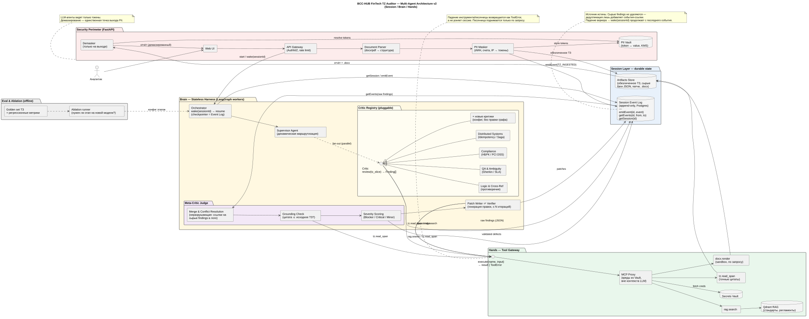

# SpecAgent

**An AI agent that audits FinTech specifications (ТЗ) the way a senior systems analyst would.** It finds the defects, proves each one with a quote, and writes the fix.

*BCC-HUB × MNU FinTech Hackathon 2026, single track: "an AI agent for analysing and checking the quality of FinTech specifications".*

*Overview (v2). Extended version with every component, models and status: [architecture-v3.svg](diagrams/architecture-v3.svg).*

---

## What it does

| You give it | You get back |
|---|---|
| A ТЗ in `.docx`, `.pdf` or `.md` | Defects, each pinned to a section with a verbatim quote |
| | A severity for each (Blocker / Critical / Major / Minor) and a 0–100 quality score |
| | A verified "before → after" fix plus Gherkin acceptance criteria for every serious defect |
| | A live trace of what each agent did, and why the judge kept each finding |

**Example.** "4.3: on error the request is retried" → **Blocker**: no idempotency key, so a network timeout leads to a double debit → fix: an `Idempotency-Key` requirement plus three Gherkin scenarios.

## Why a bank can trust it

| The bank's worry | Our answer |
|---|---|
| "The AI will leak our data" | PII is masked **before** any model sees it. Real values sit in a vault and come back only in the final report. |
| "The AI will make things up" | Every quote is checked word for word against the document. A finding without a real quote is dropped by code, not by a model. |
| "What if it crashes halfway?" | Every step is written to a durable log. A new worker carries on from the last step. |
| "Can we audit what it did?" | The same log shows every agent, every tool call and every decision. |

---

## Read the docs

| Start with | |
|---|---|
| **[Architecture](architecture.md)** | The diagram, the three layers (Session / Brain / Hands), one audit step by step |
| **[Presentation (PDF)](presentation/SpecAgent-architecture.pdf)** | The same story as 18 slides, in Russian, for the jury (source: [slides.html](presentation/slides.html)) |

| Go deeper | |
|---|---|
| [Agents](agents.md) | Each agent: its job, what it reads, what it returns, what happens when it fails |
| [Multi-agent orchestration](multi-agent-orchestration.md) | Routing, parallel critics, the judge, the fix loop, crash recovery, model choice |
| [Cross-agent protocol](cross-agent-protocol.md) | How agents pass work through the log; event types; conflict resolution |
| [Models & cost](models-and-cost.md) | Qwen vs Gemini prices, cost per audit, whether Qwen fits our agents, self-hosting |
| [C# backend](backend-csharp.md) | .NET solution, key classes, Qwen client, API endpoints, configuration |
| [PII & security](pii-and-security.md) | What gets masked and how; prompt-injection defence; anti-hallucination controls |
| [Evaluation & demo](evaluation-and-demo.md) | Test dataset, metrics, demo script, hackathon timeline and deliverables |
| [⚠️ Prototype code](prototype/README.md) | Working C# prototype: what runs today and what has not been tested |

---

## Stack

| Layer | Choice |
|---|---|
| Backend | C# / .NET 10, ASP.NET Core |
| AI | **Qwen**: `qwen4-max` for decisions, `qwen3.7-plus` for critics, `qwen3.7-flash` for routine checks (≈ $0.19 per ТЗ); self-hostable open weights |
| State | PostgreSQL append-only event log |
| Knowledge | Qdrant, consulted on every audit: rules matched to every section, plus a mandatory-rule checklist; local `Qwen3-Embedding` |
| UI | Split screen: ТЗ on the left, live agent trace and findings on the right |
| Run | `docker compose up` *(planned)* |

## Key dates

| Date | |
|---|---|
| **25 Nov** | Kick-off: the official case is published |
| **25–27 Nov** | 3 days of development |
| **27 Nov, 23:59** | Submit: demo, repository, presentation, student IDs |
| 28 Nov – 1 Dec | Jury selects 12 finalists |
| **4 Dec** | Grand Final at MNU, Astana: demo, pitch, defence |
