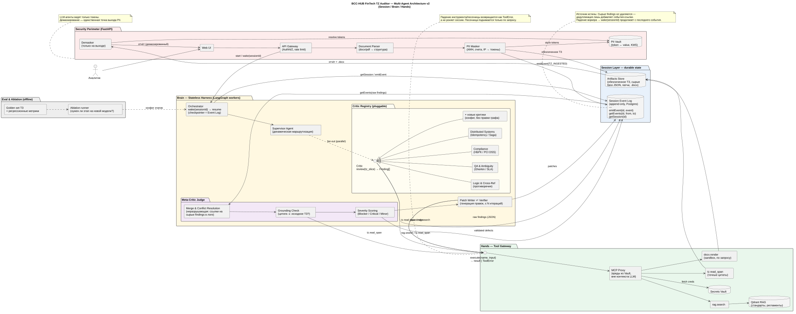
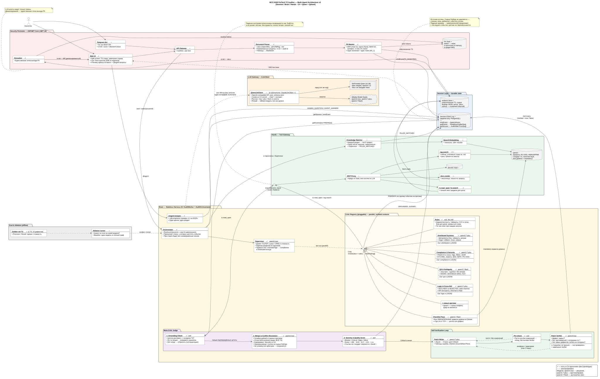

# Architecture

> **In one minute**
> - SpecAgent has three layers: **Session** (a durable log), **Brain** (stateless agents) and **Hands** (tools behind one interface). The split follows Anthropic's [*Scaling Managed Agents: Decoupling the brain from the hands*](https://www.anthropic.com/research/managed-agents).
> - A **security perimeter** wraps all three. Real customer data enters through the masker and leaves only through the demasker.
> - Any agent worker can crash. A fresh one reads the log and carries on from the last event.
> - Models: **Qwen** (`qwen4-max`, `qwen3.7-plus`, `qwen3.7-flash`); see [models-and-cost.md](models-and-cost.md). **Every agent's input is backed by Qdrant**: rules are matched to each section automatically, not only when an agent thinks to ask.

---

## The diagram

### v2: overview

[Open full size (SVG)](diagrams/architecture.svg) · [PlantUML source](diagrams/architecture.puml)

The overview: the three layers, the security perimeter and the main flow. Still valid. Two labels predate our stack: "FastAPI" (we use ASP.NET Core) and "LangGraph workers" (we use a C# orchestrator).

### v3: extended version

[Open full size (SVG)](diagrams/architecture-v3.svg) · [PlantUML source](diagrams/architecture-v3.puml)

Same structure as v2, with every box opened up. It adds:

| Added in v3 | Why |
|---|---|
| Detailed contents of every agent (what it checks, which model, what it returns) | One picture explains the whole pipeline |
| **Meta-Critic as three numbered steps:** grounding (code) → merge & conflicts (`qwen4-max`) → score (formula) | Shows which parts are deterministic |
| **Self-Verification Loop:** Writer → code pre-check → Verifier, return arrows, **max 2 rounds**, "not verified" label | The loop always ends; a failed fix is labelled, never hidden |
| **Rules critic** (code) and **Checklist Pass** (mandatory rules from Qdrant) in the Critic Registry | Floor under the AI critics, and no "nobody noticed" gap |
| **Knowledge Matcher + local Qwen3-Embedding → Qdrant**, running in parallel with the Supervisor (`RULES_MATCHED`) | Qdrant is consulted on every audit |
| **LLM Gateway:** `QwenLlmClient` with strict JSON schema and fallback, Alibaba Cloud *or* self-hosted vLLM | One interface; production can run inside the bank |
| ASP.NET Core instead of FastAPI; C# worker instead of LangGraph | Our actual stack |
| Telegram bot, SSE live trace, `@agent` questions | Second entry point and visible agents |
| ✓ / ○ on every box | Honest status: built in the prototype vs planned |

---

## Why three layers

The usual first version of an agent puts everything in one process: the prompt loop, the state and the tools. Anthropic's Managed Agents team describe what goes wrong with that design. Each point applies directly to a bank:

| Problem with "everything in one box" | What it means for a bank |
|---|---|
| The process dies, the session dies with it | A half-finished audit is lost, and so is the record of what the AI did |
| Generated code and credentials live side by side | A prompt injection hidden in a ТЗ only has to make the model read its own environment |
| You can't debug without opening the box | The box holds customer data, so in practice nobody can debug it |
| Every run pays the full setup cost up front | Slow start even for documents that never need heavy tools |

Their answer, which we adopt:

| Layer | What it is | Rule |
|---|---|---|
| **Session** | Append-only log of everything that happened | It is the only state. It lives outside the brain and the hands. |
| **Brain** | The loop that calls the model (Qwen) and routes tool calls: our orchestrator and agents | Stateless and replaceable. "Cattle, not pets." |
| **Hands** | Tools that act: read a section, search the standards, render a .docx | One interface, `execute(name, input) → string`. No credentials inside. |

---

## Layer by layer

### Security perimeter (red on the diagram)

| Component | Job |
|---|---|
| Web UI | Upload the ТЗ; see the text on the left and the findings on the right |
| API Gateway | Authentication, authorisation, rate limits |
| Document Parser | `.docx` / `.pdf` → numbered sections, so every finding points at e.g. "4.3" |
| PII Masker | ИИН, card numbers, IBAN, phones, IPs → tokens such as `[IIN_1]` |
| PII Vault | The only place that maps tokens back to real values |
| Demasker | The only exit for real values: it restores them in the final report |

**The rule:** agents and models only ever see tokens. Details are in [pii-and-security.md](pii-and-security.md).

### Session (blue)

| Component | Job |
|---|---|
| Session Event Log | Append-only table in PostgreSQL. Every step writes an event. |
| Artifacts Store | Masked ТЗ, raw findings, patches, the rendered .docx |

Operations, using the article's names:

| Operation | Meaning | In our C# code |
|---|---|---|
| `emitEvent(id, event)` | Write one event durably | `IEventStore.AppendAsync` |
| `getEvents(id, from, to)` | Read a slice of the log | `IEventStore.ReadAsync(id, afterSeq)` |
| `getSession(id)` | Read the whole session to resume | `AuditState.From(ReadAsync(id))` |

**Nothing is deleted.** When the judge merges duplicates, it writes a *link* event pointing at the raw findings. The originals stay in the log.

### Brain (yellow)

| Component | Job |
|---|---|
| Orchestrator | `wake(sessionId)`: rebuilds state from the log and runs the next stage that has no event yet |
| Supervisor | Classifies the ТЗ and decides which critics read which sections |
| Critic Registry | Pluggable critics with one interface, `review(tz_slice) → Finding[]`. They run **in parallel**. |
| Checklist Pass *(added beyond the diagram)* | For every **mandatory** rule of the ТЗ's domain, asks "where does the ТЗ cover this?" and needs a verified quote, or reports a gap |
| Meta-Critic Judge | **Merge** duplicates (non-destructively), **ground** every quote in the original ТЗ, **score** severity |
| Patch Writer ⇄ Verifier | Writes a fix; the verifier checks it against neighbouring sections; at most N rounds |

Four critics ship by default: Logic & Cross-Ref, QA & Ambiguity, Compliance (НБРК / PCI DSS), Distributed Systems (idempotency / Saga). **Adding a critic is configuration plus a prompt file.** The graph doesn't change. Every agent is described in [agents.md](agents.md).

### Hands (green)

| Component | Job |
|---|---|
| `execute(name, input) → result \| ToolError` | The single door to every tool. A failing tool returns an error *value*; the session survives. |
| MCP Proxy | Fetches credentials from the vault and calls the external service. The model never sees a credential. |
| `tz.read_span` | Exact text of a section, used for grounding quotes |
| `rag.search` | Search over standards and regulations in Qdrant, called **automatically for every routed section** (see below) |
| `docx.render` | Renders the report in a sandbox, started only when needed |
| Secrets Vault | Credentials for tools, outside the model's context |

### Knowledge: Qdrant on every step

Earlier, a critic searched the knowledge base only for what it *thought* to ask, so anything it didn't think of was never looked up. Now **code** consults Qdrant at every step, and the agents receive the rules already attached:

| When | What is searched | What it feeds |
|---|---|---|
| Right after upload, in parallel with the Supervisor | Every section's text is embedded (`Qwen3-Embedding`, local) and matched to the top 5 rules | Each critic gets **its sections plus the rules matched to those sections** |
| Checklist pass | All rules tagged **mandatory** for the ТЗ's domain (a filter, not a similarity search) | One "covered / not covered" check per rule |
| Meta-Critic | Each finding's `StandardRef` is looked up by id | A cited rule that doesn't exist in the base is flagged (code) |
| Patch Writer | Rules matched to the defect | The fix is worded the way the standard is |

What's stored: **reference rules only** (PCI DSS summaries, НБРК / АРРФР, ТЗ-writing standard, БЦК policies), one rule per entry, with source and domain tags. The ТЗ itself is never stored there; it's always read exactly through `tz.read_span`.

**Does it slow the audit down?** Barely, if the work runs in parallel. These are estimates to replace with measured numbers:

| Extra work | Typical cost | Why it barely shows |
|---|---|---|
| Embedding ~40 sections with a local model | ~0.5–3 s on CPU, well under 1 s on a GPU | Runs **in parallel with the Supervisor's model call** (a few seconds anyway) |
| Qdrant searches | milliseconds each | Negligible against model calls that take seconds |
| ~3K more prompt tokens per critic | a fraction of a second of extra reading | Models read input fast; generating output is what takes time |
| Checklist pass (~40 small `qwen3.7-flash` calls) | a few seconds in total | Runs **in parallel with the critics**, so the wait is whichever finishes last |
| Extra cost | under $0.01 per ТЗ with `qwen3.7-flash` | Included in [models-and-cost.md](models-and-cost.md) |

Net effect: roughly **0–3 seconds** on an audit that takes tens of seconds, in exchange for fewer missed defects and correct citations. Run in sequence instead of in parallel, the same work could add 5–10 seconds, so the parallelism matters.

### Eval & Ablation (grey, offline)

| Component | Job |
|---|---|
| Golden set | Labelled ТЗ with known defects, plus regression metrics |
| Ablation runner | For each new model, asks: *is this stage still needed?* |

The article makes this point too: a workaround needed by one model generation can be dead weight on the next. We measure each stage instead of keeping it out of habit. See [evaluation-and-demo.md](evaluation-and-demo.md).

---

## One audit, start to finish

| # | Step | Layer | Event in the log |
|---|---|---|---|
| 1 | Analyst uploads the ТЗ; it is parsed and masked | Perimeter | `TZ_INGESTED` |
| 2 | Orchestrator starts session `s-42` | Brain | `RUN_STARTED` |
| 3 | Supervisor routes sections to critics; *at the same time* every section is matched to rules in Qdrant | Brain → Hands | `ROUTED`, `RULES_MATCHED` |
| 4 | Four critics run in parallel, each with its sections plus their matched rules; the checklist pass runs alongside | Brain → Hands | `FINDINGS` (one per critic + checklist) |
| 5 | *A worker crashes mid-merge* | — | *(nothing: no event is lost)* |
| 6 | A fresh worker calls `wake(s-42)` and continues from the last event; critics are **not** re-run | Brain | `RESUMED` |
| 7 | Judge merges (with links), grounds every quote, scores | Brain → Hands | `MERGED`, `GROUNDED`, `SCORED` |
| 8 | Writer ⇄ Verifier produce fixes; the docx sandbox starts only now | Brain → Hands | `PATCHES`, `REPORT_RENDERED` |
| 9 | Demasker restores real values; the analyst gets the report | Perimeter | `DELIVERED` |

The prototype uses slightly coarser event names (`JUDGED` covers merge, ground and score; `REPORT_READY` covers render and deliver). The full list is in [cross-agent-protocol.md](cross-agent-protocol.md).

---

## Design principles

1. **The log is the truth.** No agent keeps memory between calls. The log is also the audit trail a bank needs.
2. **Brains are cattle.** Any worker can be killed at any time; `wake(sessionId)` replaces it.
3. **Secrets stay at the edge.** PII sits in the PII vault and credentials in the secrets vault. Neither is reachable from a model's context.
4. **One door to the hands.** Every tool sits behind `execute()`. Failures come back as `ToolError`, every call is logged, and sandboxes start on demand.
5. **Deterministic where it matters.** Masking, quote grounding, the routing floor and the severity score are plain code: same input, same output.
6. **Isolated critics, one judge.** Critics never see each other's output, so agreement means something.
7. **Measure every stage.** The ablation runner checks whether each stage still earns its cost on the current model.

---

## What the prototype covers

| Diagram component | Prototype ([prototype/](prototype/README.md)) |
|---|---|
| Web UI, Parser, PII Masker, Vault, Demasker | ✅ (vault is in memory) |
| API Gateway (auth, rate limit) | ❌ not yet |
| Session Event Log (Postgres) | ✅ written, not yet run against a real database; in-memory store tested |
| Artifacts Store | ➖ kept inside event payloads for now |
| Orchestrator with `wake()`, Supervisor, 4 critics, Judge, Patch loop | ✅ tested with a scripted model |
| Extra deterministic "rules" critic | ✅ added beyond the diagram |
| `execute()` gateway, `tz.read_span` | ✅ |
| `rag.search` | ➖ keyword search over Markdown, one fixed query per critic; Qdrant with per-section matching planned |
| Checklist Pass | ❌ not yet |
| LLM client | ➖ Claude client built; **Qwen client not yet** (one class to swap, see [models-and-cost.md](models-and-cost.md)) |
| MCP Proxy, Secrets Vault, `docx.render` sandbox | ❌ not yet |
| Golden set | ➖ one labelled demo ТЗ |
| Ablation runner | ❌ not yet |
