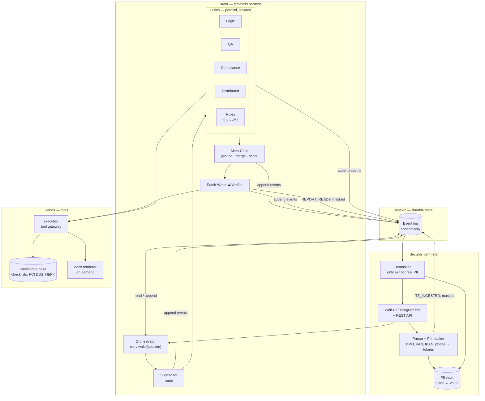
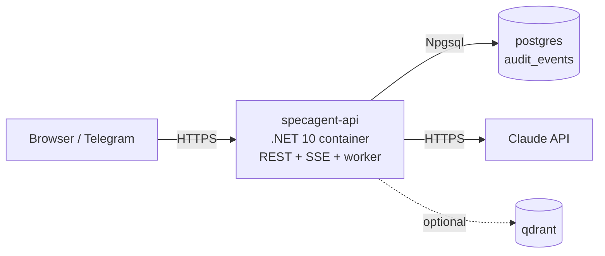

# Architecture

SpecAgent separates three things that most "LLM agent" prototypes mix together:

- **Brain** — the stateless harness that decides what to do next and calls models (orchestrator + agents).
- **Session** — the durable, append-only event log. It *is* the state of an audit.
- **Hands** — tools the agents use (read a section, search the ТЗ, search the knowledge base, render .docx), reached only through one `execute()` gateway.

Around them sits a **security perimeter**: real PII enters through the masker and leaves only through the demasker.

## One audit, step by step

| Step | What happens | Event(s) written |
|---|---|---|
| 1. Upload & mask | Parser builds the section tree; masker swaps PII for tokens; real values go to the vault | `TZ_INGESTED` (masked document) |
| 2. Start | Orchestrator opens session `s-…`, hands the job to the Supervisor | `RUN_STARTED` |
| 3. Route | Supervisor picks critics and section slices; a deterministic floor adds compliance + distributed critics for any money/PII document | `ROUTED` |
| 4. Fan out | Critics run in parallel, each with its own prompt, slice and knowledge-base context | `CRITIC_STARTED`, `TOOL_CALLED`, `FINDINGS` (one per critic) |
| 5. Ground | Every quote is checked verbatim against the document; ungrounded findings are dropped | `GROUNDED` |
| 6. Judge | Meta-Critic merges duplicates, rejects false positives, resolves conflicts, sets severity; score by formula | `JUDGED` |
| 7. Patch | Writer drafts a fix, Verifier checks it against neighbouring sections, max 2 rounds | `PATCH_DRAFTED`, `PATCH_VERIFIED`, `PATCHES` |
| 8. Deliver | Report assembled from the log; demasker restores real values for the analyst | `REPORT_READY` |

If a worker dies at any step, a new one calls `wake(session)`, replays the log, and continues from the first stage that has no event yet (`RESUMED`). Critics that already reported are **not** re-run.

## Design principles

1. **The log is the state.** No agent keeps memory between calls. Any worker can be killed and replaced. The log is also the audit trail a bank needs.
2. **Deterministic where it matters.** Routing floor, PII masking, quote grounding, severity score and the rules critic are plain code: same input, same output.
3. **Isolated critics, one judge.** Critics never see each other's output, so agreement between them means something; the judge is the only place findings meet.
4. **Contracts, not prose.** Every LLM agent returns JSON that matches a C# record (structured outputs). A malformed answer cannot enter the pipeline.
5. **Nothing is deleted.** Merged and rejected findings stay in the log; final findings link to the raw ones they came from.
6. **Least privilege for tools.** Tools are read-only and hold no credentials; a prompt injection inside a ТЗ has nothing to call and nothing to steal.
7. **Cost-aware model routing.** Strong models only for routing, judging and verification; cheaper ones for routine checks.

## Deployment view

The API and the background worker run in the same container for the hackathon; they can be split later because they share nothing except the event log.
