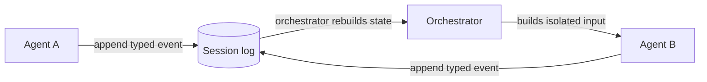
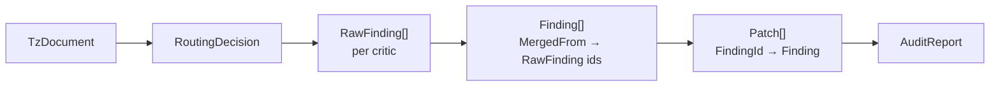

# Cross-agent protocol

How agents hand work to each other. The short version: **agents never talk directly**. They read inputs the orchestrator gives them and write typed events to the session log. The log is the only shared medium.



Why not agent-to-agent chat:
- **Independence.** Critics that see each other's output converge on the first opinion; isolated critics give the judge real votes.
- **Durability.** A message between two in-memory agents dies with the process; an event survives it.
- **Auditability.** The bank can replay exactly what each agent saw and said.
- **Cost.** No growing shared conversation that every agent pays to re-read.

## The event

```csharp
public sealed record AuditEvent(
    long Seq,                  // per-session, strictly increasing
    string SessionId,
    string Type,               // see table below
    string Agent,              // who wrote it
    DateTimeOffset At,
    string Message,            // one human-readable line for the live trace
    JsonElement? Payload);     // typed body; masked text only, never real PII
```

Storage: PostgreSQL table `audit_events (session_id, seq)` primary key, `payload jsonb`. Parallel critics append to the same session concurrently, so `seq` is assigned under a per-session advisory lock (`pg_advisory_xact_lock(hashtext(session_id))`).

## Event types

| Type | Written by | Payload | Read by |
|---|---|---|---|
| `TZ_INGESTED` | ingestion | `IngestedPayload(TzDocument masked, int PiiTokens)` | everyone (the document) |
| `RUN_STARTED` / `RESUMED` | orchestrator | — | UI, resume logic |
| `ROUTED` | supervisor | `RoutingDecision(Domain, Complexity, Routes, Rationale, ForcedByRules)` | orchestrator → critics |
| `CRITIC_STARTED` | critic | — | UI |
| `TOOL_CALLED` | tool gateway | `{ tool, args }` | audit trail |
| `FINDINGS` | each critic | `FindingsPayload(Critic, RawFinding[])` | meta-critic |
| `CRITIC_FAILED` | orchestrator | — | UI, metrics |
| `GROUNDED` | meta-critic | `{ grounded ids, ungrounded ids }` | report, metrics |
| `JUDGED` | meta-critic | `JudgeResult(Finding[], Rejected ids, QualityScore, UsedLlm)` | patch loop, report |
| `PATCH_DRAFTED` / `PATCH_VERIFIED` | writer / verifier | verifier output | UI |
| `PATCHES` | patch loop | `Patch[]` | report |
| `REPORT_READY` | orchestrator | `AuditReport` | API (demasked) |
| `RUN_FAILED` | orchestrator | — | UI, manual resume |
| `HUMAN_QUESTION` / `AGENT_ANSWER` | analyst / critic | question / `AskOutput` | UI |

## Contracts between levels

Data moves down the pipeline as typed records. Each level consumes the previous level's record, never its prose.



- `RawFinding.Id` = `{critic}-{n}` — stable, unique within the session.
- `Finding.MergedFrom` lists raw ids — **links, not copies**. The "debate" view follows these links back to each critic's original wording.
- `Patch.FindingId` points at the final finding; `Patch.SectionId` at the section it rewrites.
- Every LLM-facing record is turned into a strict JSON Schema (`additionalProperties: false`, all fields required) and sent as the structured-output format, so the model cannot return a shape the next level can't read.

## What each agent is allowed to see

| Agent | Sees | Does not see |
|---|---|---|
| Supervisor | Outline: section titles + first 300 chars | Full text, other agents |
| Critic | Its routed sections + knowledge-base excerpts | Other sections (unless routed), other critics' findings |
| Rules critic | Whole document | — |
| Meta-Critic | Whole document + all grounded raw findings | Ungrounded findings |
| Patch Writer | The defect + its section (+ verifier issues) | Other findings |
| Patch Verifier | Defect, original, patch, neighbouring sections | Writer's reasoning |
| All | Masked text only | Real PII |

## Conflict resolution

Conflicts are resolved in exactly one place — the Meta-Critic — by explicit rules in its prompt:

1. **Duplicates** (same defect from several critics) → one verdict listing all raw ids; agreement across critics is evidence, noted in the rationale.
2. **False positive** ("missing" item is specified elsewhere) → `Accept = false`, rationale names where it is specified. Rejected ids are kept in the report.
3. **Opposing recommendations** (security wants an extra OTP step, business wants frictionless UX) → a balanced recommendation, e.g. risk-based 3-D Secure only above a limit, with the reasoning in `Rationale`.
4. **Severity disagreement** → the judge decides on the shared scale; critics' severities are suggestions.

Deterministic guards around the judge: unknown ids ignored, each raw id used once, unmentioned raw findings kept.

## Tool gateway: the only way out

Agents reach anything outside their context through one door:

```csharp
Task<string> ExecuteAsync(string sessionId, string agent, string tool,
                          IReadOnlyDictionary<string, string> args, TzDocument doc, CancellationToken ct);
```

| Tool | Purpose |
|---|---|
| `tz.read_span(sectionId)` | Exact text of one section |
| `tz.search(query)` | Which sections mention something |
| `kb.search(query)` | Knowledge-base excerpts (checklists, PCI DSS, НБРК notes) |
| `docx.render` *(planned)* | Render the patched document, started on demand |

Every call is logged as `TOOL_CALLED`. Tools are read-only and hold no credentials. Errors come back as `ToolError: …` text instead of exceptions, so one bad call doesn't crash an agent.

## Human ↔ agent

The analyst is a participant in the same protocol:

```text
POST /api/audits/{id}/ask   { "agent": "@compliance", "sectionId": "4.1", "question": "проверь на IDOR" }
→ HUMAN_QUESTION  (analyst)    "@compliance [4.1] проверь на IDOR"
→ AGENT_ANSWER    (compliance) AskOutput { Answer, Findings[] }
```

The question is masked before it reaches the model, and the answer is demasked before it reaches the analyst.
