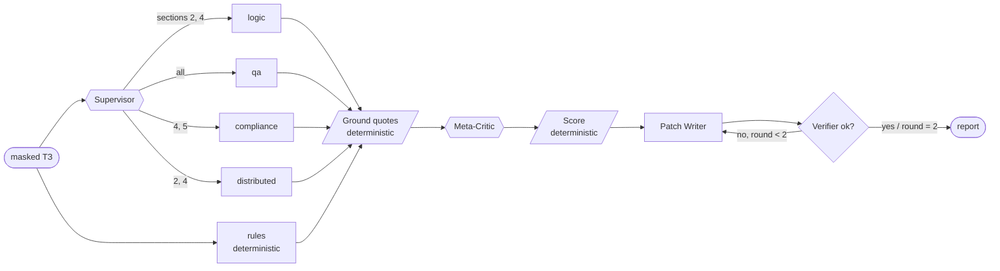
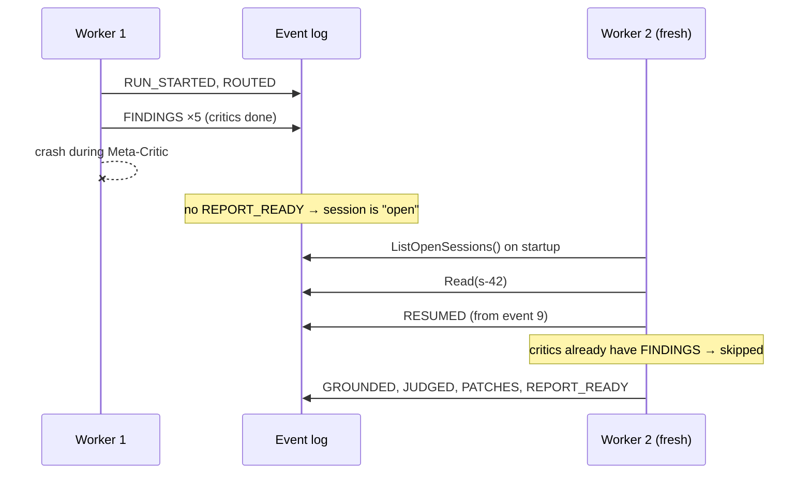

# Multi-agent orchestration

> **In one minute**
> - One method, `RunAsync(sessionId)`, both **starts** and **resumes** an audit. It skips every stage that already has an event in the log.
> - Critics run **in parallel**. Each writes its own result to the log, so nothing is held only in memory.
> - Strong models make the decisions; cheaper models do the routine reading. The split is configuration, not code.

Topology: **Supervisor → parallel specialist critics → Judge (consensus) → Writer ⇄ Verifier (critic-refiner loop)**. Subagents are only worth their cost if each one adds independent signal; this layout is designed so that they do.



## Why these levels

| Level | Why it exists | What it saves or protects |
|---|---|---|
| Supervisor | A UI redesign doesn't need a PCI DSS auditor; a payment gateway always does | Tokens and time on simple documents |
| Parallel critics | Narrow prompts find more than one big prompt; parallel runs keep latency at the slowest critic, not the sum | Recall; wall-clock time |
| Deterministic rules critic | Some defects are pattern-matchable and must never be missed | Floor on recall; offline demo |
| Grounding | Models sometimes quote text that isn't there | Hallucinated findings never reach the analyst |
| Judge | 5 critics produce duplicates and conflicts | Precision; one severity scale |
| Writer ⇄ Verifier | A fix can break the neighbouring section | Patches that are safe to paste |

## Execution model

The orchestrator is a single method, `RunAsync(sessionId)`, that is both **start** and **resume**:

```text
state = AuditState.From(log.Read(session))        // rebuild everything from events
if state.Finished: return
append RESUMED if state.Started else RUN_STARTED

routing  = state.Routing  ?? Supervisor.Route()          → append ROUTED
rules    = state.Findings[rules] ?? RulesCritic.Review()  → append FINDINGS
pending  = routing.critics without a FINDINGS event
parallel for each pending critic:                         → append CRITIC_STARTED, FINDINGS
judged   = state.Judged   ?? Ground() + Judge() + Score()  → append GROUNDED, JUDGED
patches  = state.Patches  ?? PatchLoop()                  → append PATCHES
append REPORT_READY(report)
```

- **Fan-out:** `Task.WhenAll` over the pending critics. Each critic gets its own `CriticAgent` instance and context.
- **Fan-in through the log:** each critic writes its own `FINDINGS` event as soon as it finishes. There is no in-memory merge step that could be lost.
- **Idempotent stages:** every stage first checks whether its event exists. Re-running `RunAsync` on a finished stage is a no-op.

## Crash and resume



- On startup the worker calls `ListOpenSessionsAsync()` and re-enqueues every session without a terminal event.
- `RUN_FAILED` (e.g. the API was down) is not "finished": `POST /api/audits/{id}/resume` retries it.
- Shutdown (`OperationCanceledException`) deliberately writes nothing, so the session stays open and is picked up again.

## Failure policy per agent

| Agent fails | Behaviour |
|---|---|
| Supervisor | All critics on all sections |
| One critic | `CRITIC_FAILED` + empty `FINDINGS`; others continue |
| Meta-Critic | Deterministic merge by section + quote |
| Patch writer/verifier | That patch is skipped; report still ships |
| Model refusal or error | Retry once, then the configured fallback model for that tier (e.g. `qwen3.7-plus` → `qwen3.8-flash`); otherwise treated as a failure above |

## Model routing and cost

Strong reasoning where decisions are made (Supervisor, Meta-Critic, Verifier: `qwen4-max`), mid-tier for detailed reading (logic, compliance, distributed, writer: `qwen3.7-plus`), cheapest for pattern work and the checklist pass (`qwen3.7-flash`). On the pitch this is the **cost-per-document** argument: about **$0.19 per ТЗ** on Qwen list prices, against about $0.30–0.57 on comparable Gemini models. The full table is in [models-and-cost.md](models-and-cost.md). Everything is configurable per agent:

```json
"ModelRouting": {
  "Default": { "Model": "qwen3.7-plus" },
  "Agents": {
    "supervisor":  { "Model": "qwen4-max" },
    "qa":          { "Model": "qwen3.7-flash" },
    "distributed": { "Model": "qwen3.7-plus" },
    "meta-critic": { "Model": "qwen4-max" }
  }
}
```

Before committing to a multi-model cascade, measure the simpler option too: `qwen4-max` for every agent. Pick by cost per *correct* finding on the benchmark, not per request.

## Making the agents visible (demo)

- **Live trace** — every event streams to the UI over SSE: `supervisor · ROUTED — P2P-переводы (high) → logic, qa, compliance, distributed`, `meta-critic · JUDGED — 14 → 9 findings (2 Blocker, 4 Critical, 3 Minor)`.
- **Agent logs / debate tab** — click a finding to see which critics raised it, their raw wording, and the judge's rationale (`GET /api/audits/{id}/findings/{fid}/trace`).
- **@mentions** — ask one critic about one section live.
